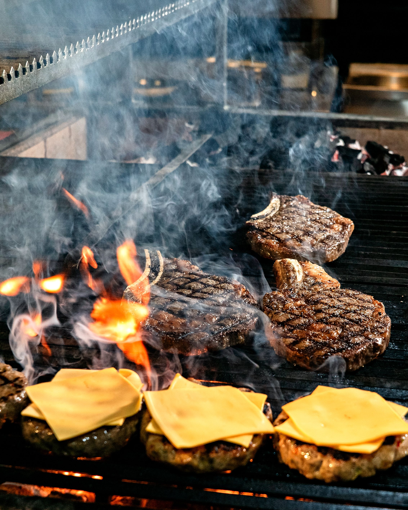
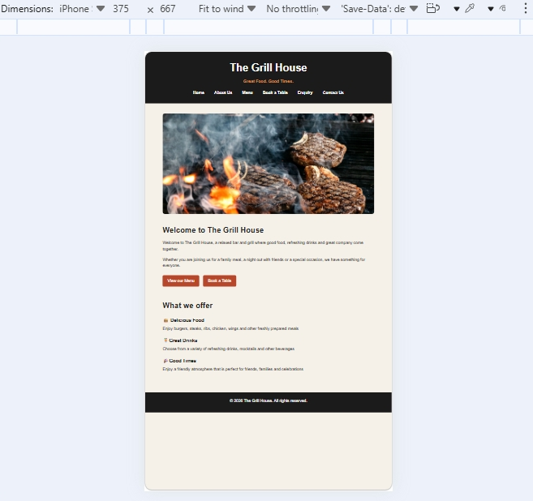
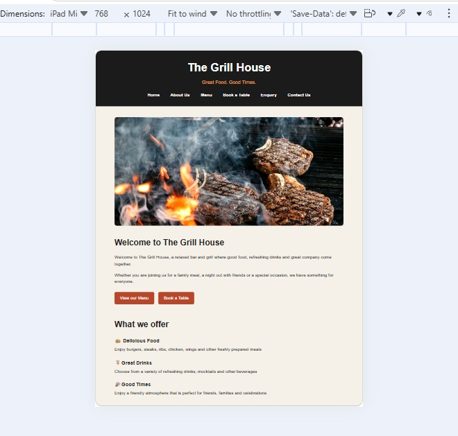
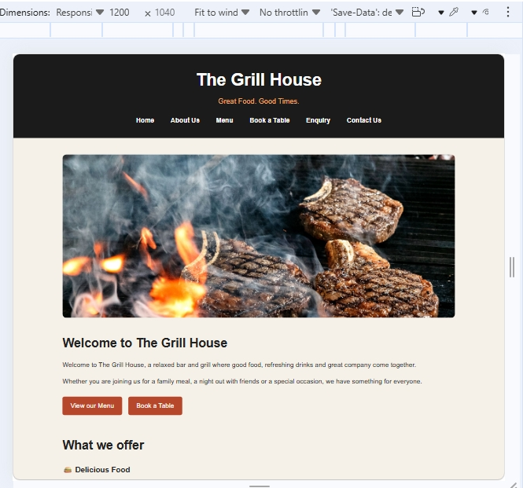
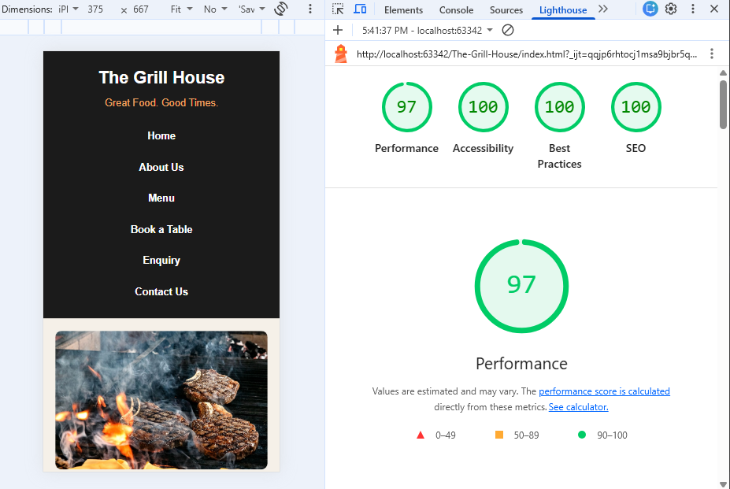

# The Grill House

## Student Information
Name: Chuma Molatlhwe
Student Number: ST10514926
Module: WEDE5020
Project: POE

## Project Overview
The Grill House is a bar and grill restaurant website developed for the WEDE5020 POE.
The website provides customers with information about the restaurant, its menu, table bookings,
enquiries and contact details.

## Website Goals and Objectives
- Create a simple and user-friendly restaurant website.
- Provide easy access to menu and restaurant information.
- Allow customers to submit table booking requests.
- Allow customers to send enquiries.
- Improve the restaurant's online presence.

## Key Features
- Home page
- About Us page
- Menu page
- Book a Table page
- Enquiry page
- Contact Us page
- Responsive and consistent website design
- Interactive booking and enquiry forms
- JavaScript confirmation messages

## Technologies Used
- HTML5
- CSS3
- JavaScript
- Git and GitHub

## Sitemap
Home
- About Us
- Menu
- Book a Table
- Enquiry
- Contact Us

## Project Timeline
- Week 1: Planning and research
- Week 2: Website design and wireframe
- Week 3: HTML development
- Week 4: CSS styling and JavaScript functionality
- Week 5: Testing, debugging and final submission

## Changelog
### Version 1.0
- Created the main website structure.
- Added six main website pages.
- Added website styling using CSS.
- Added navigation between pages.
- Added booking and enquiry forms.
- Added JavaScript confirmation messages.
- Added restaurant image and other visual elements.

### Version 2.0 - Part 2
- Improved website styling using CSS.
- Added Flexbox for navigation layout.
- Added responsive tablet and mobile breakpoints.
- Added relative units such as rem and percentages.
- Added focus and active states for interaction elements.
- Added responsive images using srcset and sizes.
- Tested the website on mobile, tablet and desktop screen sizes.
- Added responsive testing screenshots to the README.

## References
- MDN Web Docs. (n.d.). CSS Media Queries.
  Available at: https://developer.mozilla.org/en-US/docs/Web/CSS/CSS_media_queries
  Accessed: 16 September 2026.

- MDN Web Docs. (n.d.). CSS Flexible Box Layout.
  Available at: https://developer.mozilla.org/en-US/docs/Web/CSS/CSS_flexible_box_layout
  Accessed: 16 September 2026.

- MDN Web Docs. (n.d.). Responsive Images.
  Available at: https://developer.mozilla.org/en-US/docs/Web/HTML/Guides/Responsive_images
  Accessed: 16 September 2026.

- Pexels. Restaurant photography by Mohamed Olwy.
  Available at: 
  Accessed:  17 September 2026.

- MDN Web Docs. HTML, CSS and JavaScript documentation.
  Available at: https://developer.mozilla.org/
  Accessed:  17 September 2026.

- Figma. Website design and wireframing.
  Available at: https://www.figma.com/
  Accessed:  17 September 2026.

## Part 2 References

1. MDN Web Docs. (n.d.). CSS Media Queries.
   Available at: https://developer.mozilla.org/en-US/docs/Web/CSS/CSS_media_queries
   Accessed: 21 October 2026.

2. MDN Web Docs. (n.d.). CSS Flexible Box Layout.
   Available at: https://developer.mozilla.org/en-US/docs/Web/CSS/CSS_flexible_box_layout
   Accessed: 21 October 2026.

3. MDN Web Docs. (n.d.). Responsive Images.
   Available at: https://developer.mozilla.org/en-US/docs/Web/HTML/Guides/Responsive_images
   Accessed: 21 October 2026.

## Responsive Design Testing
The website was tested at different screen sizes to ensure that the layout, navigation, images and
content display correctly on mobile, tablet and desktop devices.

### Mobile View

### Tablet View

### Desktop View

## Part 3 - Enhancing Functionality and SEO

### JavaScript Enhancements

The Grill House website was improved using JavaScript to make it more interactive and user-friendly.

- Added an interactive map using Leaflet.js and OpenStreetMap.
- Added a food gallery with a lightbox that enlarges images when clicked.
- Added a dynamic menu search feature to help users find dishes.
- Added category filtering for burgers, grilled meals, sides and drinks.
- Improved the enquiry form with JavaScript validation and error messages.
- Improved the contact form with input validation and Formspree integration.
- Added response messages to provide feedback to users.

### Search Engine Optimisation (SEO)

The following improvements were made to help search engines understand the website:

- Added unique page titles and meta descriptions.
- Included relevant keywords in the website content.
- Used appropriate headings to organize page information.
- Added descriptive alt text to gallery images.
- Added lazy loading to gallery images.
- Created robots.txt to allow search engine crawling.
- Created sitemap.xml to list the six website pages.
- Used responsive design to support mobile and desktop devices.

The sitemap URLs will be updated after the website is deployed.

## Part 3 Changelog

### Version 3.0 - Final POE

- Updated website titles and meta descriptions for SEO.
- Added JavaScript validation to the enquiry and contact forms.
- Integrated Formspree to process contact form submissions.
- Added an interactive map to the Contact Us page.
- Added a food image gallery to the Menu page.
- Implemented a lightbox for enlarging food pictures.
- Added dynamic menu search and category filtering.
- Added responsive image loading and descriptive alt text.
- Created sitemap.xml and reviewed robots.txt.
- Tested JavaScript functionality and corrected syntax errors.
- Verified that contact form submissions appear in Formspree.

### Corrections from Part 2 Feedback

Feedback 1: The viewport meta tags was misspelled as "viewpoint".
Correction:
- Corrected the meta tag to "viewport".
- Checked all six HTML pages to ensure the correct tag is used.
- This helps the website display correctly on mobile devices.

Feedback 2: References did not contain URLs or accessed dates.
Correction:
- Updated README references to include websites URLs.
- Added access dates to the references.
- Improved the referencing format to make sources easier to verify.

## Part 3 References

- MDN Web Docs. JavaScript and HTML form validation.
  https://developer.mozilla.org/
  Accessed: 01 November 2026

- Leaflet. JavaScript library for interactive maps.
  https://leafletjs.com/
  Accessed: 01 November 2026

- OpenStreetMap. Map data used for the interactive map.
  https://www.openstreetmap.org/
  Accessed: 01 November 2026

- Formspree. Online form submission service.
  https://formspree.io/
  Accessed: 02 November 2026

- Google Search Central. SEO documentation.
  https://developers.google.com/search/docs
  Accessed: 02 November 2026

- Pexels. Food photography used on the website.
  https://www.pexels.com/
  Accessed: 02 November 2026

## Performance and SEO Testing - Part 3

The Grill House website was tested using Google Chrome Lighthouse.

### Lighthouse Results
- Performance: 97/100
- Accessibility: 100/100
- Best Practices: 100/100
- SEO: 100/100

The results show that the tested page performs well in loading speed, accessibility, best practices and search engine optimisation.

### Improvements Implemented
- Added lazy loading and asynchronous decoding to gallery images.
- Added descriptive alt text to images.
- Improved HTML meta tags and page titles.
- Corrected viewport settings for responsive design.
- Added robots.txt and sitemap.xml.
- Implemented JavaScript form validation.
- Used HTTPS endpoints for external services.

### Security Measures
- Contact form submissions are handled through Formspree.
- User input is validated before submission.
- Sensitive credentials are not included in frontend code.

### LightHouse Testing Screenshot
-

